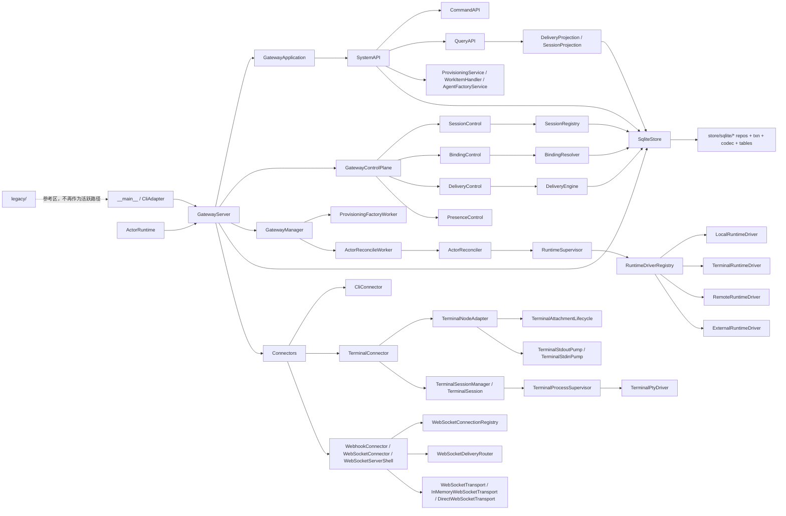

# TyrantCore v2 架构与测试状态

> 状态：核心重构已落地，v2 已切为默认活跃实现
> 日期：2026-03-26

补充说明：

- 当前活跃实现已经不只是 scaffold，`src/tyrant_core/` 默认路径已切到 v2
- `SqliteStore` 已对齐 v2 对象模型落为真实 SQLite 持久化
- `GatewayServer / SessionRegistry / BindingResolver / DeliveryEngine` 已形成最小可恢复控制平面

本文记录当前仓库里已经落地的 v2 架构、对象模型、模块边界与测试状态。后半部分仍保留设计原则，用来解释这轮重构为什么这样拆。

基本判断：

- 现有 v1 代码可作为参考实现保留
- v2 不以兼容 v1 为目标
- 旧模块整体改名并迁入 `legacy/`
- 新实现继续使用原来的模块名与主路径

---

## 0. 当前实现图

下面这张图描述的是 **当前仓库里已经落地的 v2 活跃路径**，不是未来设想图。



### 0.1 当前分层边界

- `GatewayServer` 只负责组合，不再承载细节状态机。
- `__main__` 现在默认通过 `build_embedded_runtime_gateway()` 启动活跃路径，而不是直接 new 裸 `GatewayServer()`。
- `GatewayManager` 现在负责托管任意 `start/stop` 服务，不再只限于 connector；后台 factory worker、reconcile worker、runtime supervisor 也走这一层。
- 标准 runtime builder 现在还会注册一次性 `ActorRecoveryService`，在 `gateway.start()` 时执行启动恢复。
- `GatewayApplication` 只走命令/查询主线，避免与 session / binding / delivery 混写。
- `GatewayControlPlane` 只保留控制平面编排，再下拆为 `SessionControl / BindingControl / DeliveryControl / PresenceControl`。
- connector 层只负责“接入”，terminal 的 attachment 生命周期、stdout 聚合、stdin 泵已经拆开。
- websocket connector 也已进一步拆成三块：`WebSocketConnectionRegistry / WebSocketDeliveryRouter / WebSocketTransport`；`WebSocketConnector` 只保留编排职责。
- websocket 真实网络壳层也已补上：`WebSocketServerShell` 负责 socket 协议与连接生命周期，`DirectWebSocketTransport` 负责把 transport.send 直接落到真实 socket。
- `adapters/terminal.py` 已退化为兼容入口，真实职责拆到 `TerminalPtyDriver / TerminalProcessSupervisor / TerminalSession`。
- `store/sqlite_store.py` 已退化为 façade；真实持久化职责拆到 `store/sqlite/catalog_repo.py / thread_repo.py / routing_repo.py / delivery_repo.py / txn.py / codec.py / tables.py`。
- `runtime/` 中纯对象型组件（`ExecutionManager / CapabilityRegistry / TraceRecorder / ToolRegistry`）可脱离 Gateway 单测。
- `legacy/` 已成为参考区，活跃测试与放行口径不再依赖旧路径。

### 0.2 当前测试分层

- `v2_acceptance`：覆盖 Gateway 闭环、恢复路径、core api、adapter roundtrip、系统 smoke。
- `v2_unit`：覆盖入口、gateway 子层、connector 子件、runtime 小组件、tool 组件、事件件。
- `legacy`：旧实现参考测试，不阻塞 v2 放行。
- `experimental`：实验性用例，允许独立演进。
- coverage 统计默认排除 `legacy/` 与 `legacy_main.py`，因为它们只承担参考/迁移入口职责，不属于 v2 活跃路径。

最近两次验证：

- `UV_CACHE_DIR=/tmp/.uv-cache-tyrant uv run --no-sync pytest -m "v2_acceptance or v2_unit" --cov=tyrant_core --cov-report=term-missing -q`
- 日期：`2026-03-25`
- 结果：`116 passed`
- 总 coverage：`100%`（活跃路径；默认排除 `legacy/` 与 `legacy_main.py`）
- 关键模块：
  - `gateway/*.py` façade、控制面、connector 子层均为 `100%`
  - `api/*.py` 主链路均为 `100%`
  - `runtime/*.py` 活跃组件均为 `100%`
  - `adapters/terminal_*.py` 活跃层均为 `100%`
  - `store/sqlite_store.py` façade 为 `100%`
  - `store/sqlite/*` 子模块均为 `100%`
- `uv run pytest -m "v2_acceptance or v2_unit" --cov=tyrant_core --cov-report=term-missing -q`
- 日期：`2026-03-26`
- 结果：`169 passed`
- 总 coverage：`95%`
- 增量覆盖点：`EndpointRuntimeDriver / RemoteRuntimeDriver / ExternalRuntimeDriver`、`ProvisioningQueueProcessor`、默认 embedded builder 入口、embedded CLI/provisioning smoke、webhook/websocket ingress connector、websocket connection presence、websocket egress drain、`WebSocketConnectionRegistry / WebSocketDeliveryRouter / WebSocketTransport`、多连接 `PREFER_REQUESTED / BROADCAST` 语义、`WebSocketServerShell / DirectWebSocketTransport / register_websocket_server()`
- 额外手工验证：已在真实 loopback 端口上跑通 websocket server shell 的握手、`send_text`、server push、`disconnect`

### 0.3 仍需继续提纯的难测点

- 活跃路径的纯 Python 代码已经完成覆盖收口；当前不再有结构性测试债务。
- 如果还要继续增强可信度，下一步不该继续追单测数字，而应补少量系统级 smoke：
  - 真实 pty / subprocess 受控用例
  - 真实 SQLite 文件恢复与多实例 reopen 用例
  - CLI 的端到端交互 smoke
- 当前已经补入真实 pty smoke、embedded CLI run/reopen smoke、后台 provisioning smoke、webhook ingress smoke、websocket 连接态与双向回路 smoke、websocket 多连接路由 smoke，以及真实 loopback websocket server shell 手工 smoke。
- 后续更值得补的是把 loopback websocket smoke 正式固化进测试编排，以及多进程 reopen，而不是继续打磨对象层分支。
- 这些用例的价值在于验证操作系统与运行时边界，不在于继续补对象层分支。

### 0.4 可测试性结论与下一轮拆分建议

- `GatewayServer -> Application / ControlPlane / Manager / Connectors` 这一层已经足够清晰，后续不应再回到“大一统 server”。
- `GatewayControlPlane` 的继续提纯方向不是再加 façade，而是把状态机收紧在 `SessionControl / BindingControl / DeliveryControl / PresenceControl` 内，保证每个 control 都能只依赖 `Store` 协议和少量纯函数 collaborator。
- `SqliteStore` 这一层已经完成 façade 化，真实实现已沉到 `store/sqlite/` 子包：
  - `store/sqlite/catalog_repo.py`：`Actor / OrgEdge / Grant`
  - `store/sqlite/thread_repo.py`：`Thread / Envelope`
  - `store/sqlite/routing_repo.py`：`Binding / Session / Attachment / Presence`
  - `store/sqlite/delivery_repo.py`：`Delivery / WorkItem / DomainEvent`
  - `store/sqlite/txn.py`：事务、session、upsert
  - `store/sqlite/codec.py`：row/model 与值规范化
  - `store/sqlite/tables.py`：schema 定义
- 这一拆分已经把“文件过大”和“测试定位困难”的问题压下去了；下一轮若再继续，不是继续横切技术辅助，而是按 repo 内部复杂度选择性提取纯查询/状态机函数。
- terminal 子系统已经完成第一次拆分。下一轮如果还要提纯，优先把“纯状态机”和“真实系统交互”进一步分隔：
  - `TerminalSession` 保留会话状态与编排
  - `TerminalProcessSupervisor` 只负责进程生命周期
  - `TerminalPtyDriver` 只负责 pty 原语
  - 这样单测只测状态机，smoke 测试只测 driver/process
- 查询侧已经适合继续走“投影只读化”路线。`QueryAPI` 和 projections 应避免反向卷入 command/gateway 依赖，测试上也应坚持 snapshot/fake store，不要每次都启动完整 gateway。
- 创建平面已经形成可单测的四段式职责：
  - `ProvisioningService` 负责请求与记录
  - `ProvisioningWorkItemHandler` 负责把指定 `PROVISION_ACTOR` 工单推进为执行
  - `ProvisioningQueueProcessor` 负责从待处理工单中安全领取下一条并驱动 handler
  - `AgentFactoryService` 现在只是兼容命名别名，不再承载新的设计语义
- 如果需要常驻消费创建队列，再上一层使用 `ProvisioningFactoryWorker`
  - `tick()`：单步处理一条
  - `start()/stop()`：后台循环轮询
  - `GatewayServer.register_provisioning_worker(...)`：按新命名把 worker 注册进 `GatewayManager`
  - `GatewayServer.register_factory_worker(...)`：保留为兼容别名
- 如果需要常驻把管理态目标收敛到运行态，再上一层使用 `ActorReconcileWorker`
  - `tick()`：执行一次 `reconcile_all()`
  - `start()/stop()`：后台循环轮询
  - `GatewayServer.register_reconcile_worker(...)`：把 worker 注册进 `GatewayManager`
- 运行平面现在已经形成“监督器 + driver registry + 具体 driver”三段式：
  - `RuntimeSupervisor`：负责装配持久化 attachment/presence 与 runtime 生命周期
  - `RuntimeDriverRegistry`：负责按 `ActorControl.runtime_kind` 路由 driver
  - `LocalRuntimeDriver`：只是 `LOCAL` runtime 的一个实现
  - `TerminalRuntimeDriver`：只是 `TERMINAL` runtime 的一个实现
  - `RemoteRuntimeDriver`：把远端 consumer / websocket operator 声明为 `CONNECTOR` attachment
  - `ExternalRuntimeDriver`：把 webhook / 外部 connector 声明为 `WEBHOOK` attachment
  - 标准 builder 会把 `RuntimeSupervisor` 注册进 `GatewayManager`，这样 `gateway.stop()` 会显式回收已拉起的 runtime
- 启动恢复现在单独落在管理平面：
  - `ActorRecoveryService`：在 `gateway.start()` 时执行一次 `reconcile_actor/reconcile_all` 风格的恢复
  - 默认 `strict=False`：单个 actor 恢复失败会记录到 `failures`，但不阻塞整个 gateway 启动
- 本地 runtime 进一步形成“driver + 行为注册表 + 行为包安装器 + 显式组装器”四段式：
  - `LocalRuntimeDriver`：负责 attachment/presence 与消费循环
  - `LocalRuntimeBehaviorRegistry`：只负责把声明式配置解析为 handler
  - `install_builtin_local_runtime_behaviors()`：负责把 builtin 行为包装进注册表
  - `build_local_runtime_gateway()`：负责标准组装，并默认安装 builtin 行为包与 `LOCAL` driver
- terminal runtime 当前复用现有 terminal 子系统：
  - `TerminalRuntimeDriver`：负责 session / adapter 生命周期
  - `TerminalSessionManager`：负责终端 session
  - `TerminalNodeAdapter`：负责 stdout/stdin 与 Gateway 的桥接
  - `build_embedded_runtime_gateway()`：负责标准组装，并默认注册 `LOCAL + TERMINAL + REMOTE + EXTERNAL` driver
- websocket ingress/egress 当前已经形成“连接表 + 路由器 + 传输壳层 + connector 编排 + 网络 shell”五段式：
  - `WebSocketConnectionRegistry`：负责活跃连接登记与 actor 归属
  - `WebSocketDeliveryRouter`：负责 `PREFER_REQUESTED / LAST_ACTIVE / FIRST_ACTIVE / BROADCAST` 路由策略
  - `WebSocketTransport`：抽象传输壳层；默认实现是 `InMemoryWebSocketTransport`
  - `DirectWebSocketTransport`：把 transport.send 直接写入真实 websocket socket
  - `WebSocketConnector`：负责 `binding/session` ingress、attachment/presence 生命周期，以及 `pump_outbound_once()` 的 `lease -> route -> transport -> ack` 编排
  - `WebSocketServerShell`：负责 websocket 握手协议、client command dispatch、后台 egress pump，与 `WebSocketConnector` 组合成真实网络入口
- 这一层下一步不该再回到“大而全 websocket connector”，而应只补更多生产级协议细节与网络 smoke。
- 声明式 endpoint runtime 现在独立成一类：
  - `EndpointRuntimeDriver`：抽象“声明 attachment/presence，但不持有本地执行循环”的 runtime 模式
  - `RemoteRuntimeDriver` / `ExternalRuntimeDriver`：只是两种 endpoint runtime 的具体包装
  - 这让“本地运行中的 agent”和“被 gateway 管理的外部接入点”在对象模型上统一，但在实现上仍保持分层
- `legacy/` 应继续视为参考区，不再为其新增放行测试。这样测试预算可以集中在活跃路径，而不是被兼容层稀释。

### 0.5 当前使用逻辑

当前 v2 的“使用”本质上不是“创建一个会自动收消息的 Agent 进程”，而是下面几层的组合：

1. 创建身份
   - 用 `GatewayServer.create_actor()` / `SystemAPI.create_actor()` 创建 `Actor`
   - 这一步只产生身份，不会自动附带 runtime、session、binding 或 presence
2. 如有需要，建立组织关系
   - 用 `create_org_edge(kind="REPORTS_TO")` 建上下级
   - v2 当前允许显式建边；它不是 v1 那种“只能通过 create_agent 原子建立”的模式
3. 如有需要，建立接入与在线状态
   - 用 `register_attachment()` 声明这个 actor 以什么方式接入
   - 用 `report_presence()` 报告 attachment 当前是否在线
4. 发送消息
   - 入口通常走 connector，例如 CLI 走 `CliConnector.send_text()`
   - connector 先 `open_session()`，再调用 `gateway.ingest()`
   - `ingest()` 最终进入 `CommandAPI.send_envelope()`
   - `send_envelope()` 会保存 `Envelope`，并按接收人生成一条或多条 `Delivery`
5. 消费消息
   - 接收方不会被系统自动 push
   - 接收方要自己调用 `lease_deliveries()` 或 `ActorRuntime.consume_once()`
   - 成功处理后 `ack_delivery()`；失败则 `fail_delivery()`
   - 如果使用 `LocalRuntimeDriver`，这一步也可以由后台本地消费循环自动完成
6. 生成下属 actor
  - 上层可以走 `request_actor_provision()` 创建 `ProvisionRequest + WorkItem`
  - 再由 `process_provision_work_item()` 处理指定工单，或者由 `process_next_provision_work_item()` 让默认 `ProvisioningQueueProcessor` 自己从队列领取下一条
   - 如果要常驻消费创建队列，可以在 `GatewayServer` 上注册 `ProvisioningFactoryWorker`
   - 创建成功后由 `reconcile_actor()` / `reconcile_all()` 按 `ActorControl.desired_state` 决定是否拉起 runtime
   - 如果要常驻收敛运行态，可以在 `GatewayServer` 上注册 `ActorReconcileWorker`

补充：

- 当前仓库已经提供默认 `LocalRuntimeDriver`，可以驱动本地 `ActorRuntime` 消费循环，或在没有 handler 时以 idle 模式上线。
- `RuntimeSupervisor` 不再直连单个 driver，而是通过 `RuntimeDriverRegistry` 按 `ActorControl.runtime_kind` 解析实现；未注册的 runtime kind 会显式报错。
- `TERMINAL` runtime 当前的配置优先放在 `ActorControl.placement["terminal_runtime"]`；也兼容从 `ActorProfile.bootstrap_policy["terminal_runtime"]` 与 `Actor.metadata.bootstrap["terminal_runtime"]` 继承默认值。
- `REMOTE` runtime 当前的配置优先放在 `ActorControl.placement["remote_runtime"]`；也兼容 `remote` 别名，以及从 `ActorProfile.bootstrap_policy`、`Actor.metadata`、`Actor.metadata.bootstrap` 继承。
- `EXTERNAL` runtime 当前的配置优先放在 `ActorControl.placement["external_runtime"]`；也兼容 `external` 别名，以及从 `ActorProfile.bootstrap_policy`、`Actor.metadata`、`Actor.metadata.bootstrap` 继承。
- `REMOTE / EXTERNAL` 属于声明式 endpoint runtime：它们会生成 `Attachment + Presence`，并参与 recovery / detach，但不会在本地拉起消费循环。
- `LocalRuntimeBehaviorRegistry` 会按下面的优先级解析本地运行行为：
  - `ActorProfile.bootstrap_policy["local_runtime"]`
  - `Actor.metadata["local_runtime"]`
  - `Actor.metadata["bootstrap"]["local_runtime"]`
- 这意味着：
  - profile 可以给一类 actor 提供默认行为
  - blueprint 可以通过 `bootstrap_spec.local_runtime` 覆盖 profile 默认行为
- 也已经提供标准组装器 `build_local_runtime_gateway()`，用于一次性装配：
  - `GatewayServer`
  - `LocalRuntimeDriver`
  - `RuntimeDriverRegistry`
  - `RuntimeSupervisor`
  - `ActorReconciler`
- `build_local_runtime_gateway()` 默认会安装 builtin local runtime behavior pack，并把 `LOCAL` driver 注册进 runtime registry；如果需要更换行为集合，可以自行传入 `behavior_registry`
- 也已经提供 `build_embedded_runtime_gateway()`，用于一次性装配：
  - `GatewayServer`
  - `LocalRuntimeDriver`
  - `TerminalRuntimeDriver`
  - `RuntimeDriverRegistry`
  - `RuntimeSupervisor`
  - `ActorReconciler`
- 但这些能力仍保持为“显式组装”：
  - 默认 `GatewayServer()` 不会自动启用 local runtime
  - factory worker 和 reconcile worker 仍需显式注册

这个模型里：

- `Envelope` 是通信事实
- `Delivery` 是“某个接收人待处理/处理中/已完成”的投递状态
- `Actor` 只是身份，不等于正在运行中的 agent

### 0.6 消息是怎么被助手收到的

当前活跃路径里，“助手收到消息”走的是 lease/ack 模式，不是回调推送模式。

主链路如下：

```text
人类输入
-> CliAdapter.send_text()
-> CliConnector.send_text()
-> GatewayServer.open_session()
-> GatewayServer.ingest()
-> CommandAPI.send_envelope()
-> store.save_envelope()
-> store.save_delivery() * N
-> 助手侧主动 lease_deliveries()
-> get_envelope(delivery.envelope_id)
-> handler(envelope, delivery)
-> ack_delivery() / fail_delivery()
```

对应代码位置：

- 发送入口：`src/tyrant_core/adapters/cli.py`
- connector 接入：`src/tyrant_core/gateway/connectors/cli.py`
- 落库命令：`src/tyrant_core/api/command_api.py`
- 投递状态机：`src/tyrant_core/gateway/delivery_engine.py`
- 消费运行时：`src/tyrant_core/runtime/actor_runtime.py`

`ActorRuntime.consume_once()` 的行为非常直接：

- 先按 `actor_id + consumer_id` 领取若干条 delivery 租约
- 再根据 `delivery["envelope_id"]` 取回 envelope
- 把 `envelope + delivery` 交给 handler
- handler 如果返回了 reply spec，就再发一条新的 envelope
- 最后 ack；异常则 fail

因此当前系统语义是：

- TyrantCore 负责“把消息记下来，并为收件人产生待处理 delivery”
- Runtime/connector 负责“主动来领活，再决定怎么处理”
- 外部 connector 当前也已经具备最小 ingress 语义：
  - `WebhookConnector.receive_event()`：`resolve_binding -> open_session -> ingest`
  - `WebSocketConnector.send_text()/send_payload()`：`resolve_binding -> open_session -> ingest`
  - 这两类 connector 当前作为 trusted ingress，默认 `bypass_policy=True`
  - `WebSocketConnector.connect()/disconnect()`：会把持续连接登记成 `CONNECTOR` attachment + `ONLINE/OFFLINE` presence
  - `WebSocketConnector.pump_outbound_once()`：会按 actor 领取 delivery，再按路由策略送入 transport，并在送达 transport 后 ack
  - `WebSocketConnector.receive_once()`：等于 `pump_outbound_once() + transport.receive_once()`
  - 当前支持 `PREFER_REQUESTED / LAST_ACTIVE / FIRST_ACTIVE / BROADCAST` 四种连接路由模式，默认是 `PREFER_REQUESTED`
  - 如果需要真实网络入口，可以用 `GatewayServer.register_websocket_server()` 注册 `WebSocketServerShell`
  - `WebSocketServerShell` 当前约定的首条消息必须是 `{"type":"connect", ...}`，随后支持 `send_text / send_payload / ping / disconnect`

### 0.7 “生成 agent 下属”现在到底怎么处理

这里需要明确区分“创建请求”“创建消费”“运行态拉起”这三件事。

当前活跃路径已经具备正式的创建平面，但它不是 v1 那种单一巨型 `create_agent()`。

当前链路如下：

1. 提交创建请求
   - 调 `request_actor_provision()`
   - 系统会同时创建：
     - `WorkItem(kind="PROVISION_ACTOR")`
     - `ProvisionRequest`
   - 两者通过 `provision_request_id` 关联
2. 消费创建工单
   - 两种方式：
     - `process_provision_work_item(work_item_id=...)`：处理指定工单
     - `process_next_provision_work_item(owner_actor_id=...)`：让默认 `AgentFactoryService` 从该 owner 的待处理工单里原子领取下一条
3. 落地对象
   - 默认 `TemplateProvisioner` 会创建：
     - `Actor`
     - `OrgEdge(kind="REPORTS_TO")`
     - `ActorControl`
4. 拉起运行态
   - `ProvisionRequest SUCCEEDED` 只表示核心对象已经创建成功
   - actor 是否上线，由 `reconcile_actor()` / `reconcile_all()` 和 `RuntimeSupervisor` 决定

因此现在“子 agent”不是一个新对象，而是下面几层的组合：

- `Actor`
- `OrgEdge(REPORTS_TO)`
- `ActorControl`
- 可选 `Attachment / Presence`

这也意味着现在可以把职责稳定地拆开：

- `Provisioner` 只负责“怎么造出对象”
- `AgentFactoryService` 只负责“怎么从工单队列领取并驱动创建”
- `RuntimeSupervisor` 只负责“怎么让创建出来的 actor 真正在线”

这比回退到单一 `create_agent()` 更稳定，因为创建、管理、运行三条链路已经可以独立替换和测试。

---

## 1. 重构目标

TyrantCore v2 重新定义为：

**AI 组织控制平面 + Gateway 驱动的消息/任务基础设施**

它不再是“本地 Agent + 简单消息总线”的系统，而是一个具备以下能力的内核：

- 管理 AI 组织中的身份、层级、授权与工作分配
- 通过 Gateway 接入本地运行时、CLI、终端、Webhook、IM、外部 Agent
- 把“逻辑通信事实”和“投递状态”拆开建模
- 把“组织对象”和“运行时附着状态”拆开建模
- 把“核心领域模型”和“runtime trace / UI 适配”拆开建模

---

## 2. v1 的主要结构问题

当前 v1 的核心问题不是某几个 bug，而是对象边界本身不干净。

### 2.1 `Node` 过载

当前 `Node` 同时承载：

- 身份
- 组织位置
- 权限
- endpoint
- 在线状态
- agent_config
- 服务发现标签

这导致“谁是 Actor”“在哪里运行”“现在是否在线”“具备什么能力”被塞进同一个对象。

### 2.2 `Message` 过轻

当前 `Message` 既是逻辑消息，又隐含投递意图：

- `to` 支持 `str | list[str]`
- ACK 在 `deliveries` 表里
- inbox 又依赖 `messages + deliveries + 内存 queue`

这说明系统实际需要的是：

- 不可变通信事实
- 一等的投递状态机

而不是一个简单的 `Message` 模型。

### 2.3 授权模型分裂

当前授权被拆成两套：

- `Node.permissions`
- `Delegation`

这样很难统一表达：

- 权限来源
- 可审计性
- 作用域包含关系
- 过期
- 再委托限制

### 2.4 Runtime 痕迹误入核心模型

`ConversationTurn` 是执行痕迹，不是基础设施核心对象。

它应该属于 runtime trace，而不是与 `Node / Message / Task / Event` 同级。

### 2.5 `MessageBus` 混合了 3 类职责

当前 `MessageBus` 同时负责：

- 逻辑路由
- 进程内 queue
- 恢复与 ACK 入口

这阻碍了 Gateway 层的建立。

---

## 3. v2 设计原则

### 3.1 核心语义与接入机制分离

Core 负责：

- 身份
- 组织结构
- 授权
- 工作项
- 线程
- 信封消息
- 投递状态

Gateway 负责：

- 外部接入
- 会话映射
- routing binding
- presence
- delivery lease/ack/retry

### 3.2 逻辑事实与过程状态分离

一个对象如果既表示“事实”，又表示“处理过程”，大概率会失真。

所以 v2 明确拆开：

- `Envelope`：通信事实
- `Delivery`：投递过程
- `WorkItem`：工作事实
- `Execution` / `TraceEvent`：执行过程

### 3.3 身份与附着分离

Actor 不等于进程，不等于 endpoint，不等于 session。

因此：

- `Actor` 表示身份
- `Attachment` 表示当前接入方式
- `Presence` 表示当前在线状态
- `Session` 表示上下文会话

### 3.4 Gateway 是控制平面，不是业务内核

借鉴 OpenClaw 的地方：

- Gateway 常驻控制平面
- binding / session / routing 是一等概念
- 接入协议统一
- presence 和连接能力统一管理

不照搬的地方：

- 不引入 OpenClaw 的产品对象模型
- 不把 TyrantCore 的组织/权限/任务语义交给 Gateway

---

## 4. v2 核心对象模型

v2 的核心对象分为 4 组：

1. 身份与组织
2. 通信与投递
3. Gateway 与接入
4. 工作与执行

### 4.1 身份与组织

#### `Actor`

替代 v1 的 `Node`，仅表示“谁”。

建议字段：

| 字段 | 类型 | 说明 |
|------|------|------|
| id | string | uuid4 |
| kind | enum | TYRANT / HUMAN / AGENT / SERVICE / TERMINAL / EXTERNAL |
| name | string | 显示名 |
| slug | string | 稳定标识，供 runtime / gateway 使用 |
| org_role | string | 可选，组织角色标签 |
| tags | list[str] | 服务发现标签 |
| metadata | dict | 扩展信息 |
| created_at | datetime | UTC |
| archived_at | datetime? | 归档时间 |

明确不再放入 `Actor` 的字段：

- endpoint
- status
- permissions
- agent_config

#### `OrgEdge`

替代 v1 的 `Relation`。

建议只保留真正有业务语义的组织关系：

- `REPORTS_TO`
- `MEMBER_OF`（可选，用于团队/编组）

不建议继续把 `CONNECTED` 作为核心事实长期保留。
若需要“可通信同级”，应通过策略或投影推导，而不是主事实。

建议字段：

| 字段 | 类型 | 说明 |
|------|------|------|
| id | string | uuid4 |
| kind | enum | REPORTS_TO / MEMBER_OF |
| src_actor_id | string | 起点 |
| dst_actor_id | string | 终点 |
| metadata | dict | 扩展信息 |
| created_at | datetime | UTC |
| ended_at | datetime? | 结束时间 |

#### `Grant`

替代 `Node.permissions + Delegation`。

`Grant` 是一等授权对象，统一表达：

- 直接授权
- 委托授权
- 系统隐含授权

建议字段：

| 字段 | 类型 | 说明 |
|------|------|------|
| id | string | uuid4 |
| subject_actor_id | string | 被授权者 |
| action | string | 权限动作 |
| effect | enum | ALLOW / DENY |
| scope_type | enum | GLOBAL / SUBTREE / ACTORS / THREADS / WORK_ITEMS |
| scope_targets | list[str] | 范围目标 |
| source_type | enum | DIRECT / DELEGATED / IMPLICIT / SYSTEM |
| source_actor_id | string? | 授权来源 |
| delegable | bool | 是否允许继续委托 |
| expires_at | datetime? | 过期时间 |
| created_at | datetime | UTC |
| revoked_at | datetime? | 撤销时间 |

---

### 4.2 通信与投递

#### `Thread`

把 v1 中可选的 `thread_id` 提升为一等对象。

线程不是附属字段，而是上下文的锚点。

建议字段：

| 字段 | 类型 | 说明 |
|------|------|------|
| id | string | uuid4 |
| kind | enum | DIALOG / TASK / SYSTEM / INCIDENT |
| subject | string | 简短主题 |
| created_by | string | 创建者 |
| participants | list[str] | 参与 Actor |
| metadata | dict | 扩展信息 |
| created_at | datetime | UTC |
| closed_at | datetime? | 关闭时间 |

#### `Envelope`

替代 v1 的 `Message`，表示不可变通信事实。

重点变化：

- `to` 不再允许 list
- 一个 `Envelope` 只表达一次发送事实
- 多播由命令层展开成多个 `Delivery`

建议字段：

| 字段 | 类型 | 说明 |
|------|------|------|
| id | string | uuid4 |
| thread_id | string | 所属线程 |
| sender_actor_id | string | 发送者 |
| kind | string | CHAT / REPORT / NOTIFICATION / CONTROL |
| payload | dict | 消息体 |
| priority | enum | SYSTEM / URGENT / NORMAL / LOW |
| correlation_id | string? | 关联 ID |
| idempotency_key | string? | 幂等键 |
| references | list[Reference] | 引用 |
| created_at | datetime | UTC |
| expires_at | datetime? | 过期时间 |

#### `Delivery`

一等投递状态机，替代 v1 对 inbox / deliveries / ack 的混合表达。

建议状态：

- `PENDING`
- `LEASED`
- `DELIVERING`
- `DELIVERED`
- `ACKED`
- `FAILED`
- `DEAD_LETTER`

建议字段：

| 字段 | 类型 | 说明 |
|------|------|------|
| id | string | uuid4 |
| envelope_id | string | 对应消息 |
| recipient_actor_id | string | 接收者 |
| target_attachment_id | string? | 指向当前投递目标 |
| state | enum | 投递状态 |
| attempt_count | int | 重试次数 |
| lease_owner | string? | 当前 worker / gateway |
| lease_expires_at | datetime? | lease 过期时间 |
| delivered_at | datetime? | 已送达时间 |
| acked_at | datetime? | 已确认时间 |
| next_retry_at | datetime? | 下次重试 |
| last_error | dict? | 最后错误 |
| created_at | datetime | UTC |

`Delivery` 是 v2 的关键对象之一。
没有它，Gateway 只能是一个外壳。

---

### 4.3 Gateway 与接入

#### `Binding`

借鉴 OpenClaw 的核心灵感之一：路由绑定必须是一等对象。

`Binding` 用于把外部输入稳定地映射到内部 Actor / Thread。

建议字段：

| 字段 | 类型 | 说明 |
|------|------|------|
| id | string | uuid4 |
| surface | string | cli / terminal / webhook / telegram / discord / ws |
| account_id | string? | 账号维度 |
| peer | string? | 对端标识 |
| actor_id | string | 绑定到哪个 Actor |
| thread_policy | enum | REUSE / NEW_PER_MESSAGE / BY_PEER / BY_TASK |
| fixed_thread_id | string? | 固定线程 |
| priority | int | 匹配优先级 |
| created_at | datetime | UTC |
| disabled_at | datetime? | 禁用时间 |

#### `Session`

会话表示“接入上下文”的存续状态，而不是 Actor 本身。

建议字段：

| 字段 | 类型 | 说明 |
|------|------|------|
| id | string | uuid4 |
| surface | string | 接入面 |
| binding_id | string? | 命中的 binding |
| actor_id | string | 当前会话归属 Actor |
| thread_id | string | 当前线程 |
| external_key | string | 外部会话键 |
| mode | enum | PERSISTENT / EPHEMERAL |
| state | enum | OPEN / IDLE / CLOSED |
| last_seen_at | datetime | 最近活动时间 |
| created_at | datetime | UTC |
| closed_at | datetime? | 关闭时间 |

#### `Attachment`

表示某个 Actor 现在如何附着到系统。

例如：

- 本地 ADK runtime
- terminal node
- websocket consumer
- 外部 webhook connector

建议字段：

| 字段 | 类型 | 说明 |
|------|------|------|
| id | string | uuid4 |
| actor_id | string | 所属 Actor |
| kind | enum | LOCAL_RUNTIME / TERMINAL / UI / CONNECTOR / WEBHOOK |
| endpoint | dict | 地址与配置 |
| capabilities | list[str] | 能力声明 |
| desired_state | enum | ACTIVE / PAUSED / DETACHED |
| created_at | datetime | UTC |
| detached_at | datetime? | 解除附着时间 |

#### `Presence`

表示当前在线或可投递状态。

建议字段：

| 字段 | 类型 | 说明 |
|------|------|------|
| attachment_id | string | 当前附着 |
| actor_id | string | 关联 Actor |
| gateway_id | string | 所属 gateway 实例 |
| status | enum | ONLINE / BUSY / OFFLINE / DEGRADED |
| leases | int | 当前持有 lease 数 |
| last_heartbeat_at | datetime | 最近心跳 |

---

### 4.4 工作与执行

#### `WorkItem`

替代 v1 的 `Task`。

之所以改名，是为了避免把对象限制在“任务分派”语义上。
未来它还可以表达审批、调查、批处理、工作单等概念。

建议字段：

| 字段 | 类型 | 说明 |
|------|------|------|
| id | string | uuid4 |
| kind | string | TASK / INVESTIGATION / REVIEW / BATCH |
| creator_actor_id | string | 创建者 |
| owner_actor_id | string | 当前负责人 |
| thread_id | string | 所属线程 |
| parent_work_item_id | string? | 父工作项 |
| status | enum | PENDING / IN_PROGRESS / BLOCKED / COMPLETED / FAILED / CANCELED |
| spec | dict | 工作说明 |
| result | dict | 执行结果 |
| created_at | datetime | UTC |
| updated_at | datetime | UTC |
| closed_at | datetime? | 完成/终止时间 |

#### `Execution`

表示某个 Actor 对某个线程/工作项的一次执行上下文。

建议字段：

| 字段 | 类型 | 说明 |
|------|------|------|
| id | string | uuid4 |
| actor_id | string | 执行者 |
| thread_id | string | 所属线程 |
| work_item_id | string? | 关联工作项 |
| trigger_envelope_id | string? | 触发输入 |
| status | enum | RUNNING / WAITING / COMPLETED / FAILED |
| runtime_kind | string | adk / terminal / webhook / manual |
| started_at | datetime | UTC |
| ended_at | datetime? | 结束时间 |

#### `TraceEvent`

替代 v1 的 `ConversationTurn`。

它属于 runtime / trace 域，不属于核心模型层。

建议类型：

- `INPUT_ACCEPTED`
- `MODEL_OUTPUT`
- `TOOL_CALL`
- `TOOL_RESULT`
- `DELIVERY_ACKED`
- `WORK_ITEM_UPDATED`
- `ERROR`

---

## 5. 对象关系总览

```text
Actor
  ├─ OrgEdge ──> Actor
  ├─ Grant
  ├─ Attachment
  ├─ Presence
  ├─ Session
  ├─ Thread
  ├─ Envelope
  ├─ Delivery
  └─ WorkItem

Thread
  ├─ Envelope
  ├─ Session
  ├─ WorkItem
  └─ Execution

Envelope
  └─ Delivery

Execution
  └─ TraceEvent
```

---

## 6. v2 模块设计

### 6.1 模块改名原则

用户要求：

- 老的模块改名，仅保留参考
- 新的实现继续使用原来的模块名

因此建议采用以下迁移方式。

### 6.2 旧模块迁移到 `legacy/`

```text
src/tyrant_core/
  legacy/
    __main__.py
    models.py
    store/
    bus/
    api/
    runtime/
    adapters/
```

迁移原则：

- 旧代码整体搬到 `src/tyrant_core/legacy/`
- 内部 import 改为 `tyrant_core.legacy.*`
- 不再在生产路径中直接引用 legacy 模块
- legacy 只用于参考、对照、局部复用与测试回看

### 6.3 新模块继续占用原路径

```text
src/tyrant_core/
  __main__.py
  config.py
  models.py
  store/
  bus/
  api/
  gateway/
  runtime/
  adapters/
  projections/
```

### 6.4 各模块职责

#### `models.py`

只保留核心领域模型：

- Actor
- OrgEdge
- Grant
- Thread
- Envelope
- Delivery
- WorkItem
- Binding
- Session
- Attachment
- Presence
- 领域异常

不再放入：

- TraceEvent
- runtime 专用对象
- 兼容旧模型的临时别名

#### `store/`

新 `store` 负责：

- 核心对象持久化
- 事件日志追加
- projection 刷新
- lease / retry / ack 原语

建议子模块：

```text
store/
  base.py
  sqlite_store.py
  migrations.py
  projections.py
```

#### `bus/`

v2 的 `bus/` 不再是“消息总线”。

新职责：

- 领域事件流
- projection 更新通知
- 本地订阅 hub

建议子模块：

```text
bus/
  event_stream.py
  subscription_hub.py
```

不建议继续保留 `message_bus.py` 作为核心入口。

#### `api/`

`api/` 变成命令与查询的正式边界。

建议拆分：

```text
api/
  command_api.py
  query_api.py
  policies.py
```

`command_api.py` 负责：

- create_actor
- move_actor
- grant
- revoke
- open_thread
- send_envelope
- create_work_item
- update_work_item
- attach_actor
- bind_surface

`query_api.py` 负责：

- actor 查询
- thread 查询
- delivery 查询
- inbox / pending work 投影查询
- gateway session / binding 查询

#### `gateway/`

这是 v2 新增的核心模块。

建议结构：

```text
gateway/
  server.py
  protocol.py
  manager.py
  binding_resolver.py
  session_registry.py
  delivery_engine.py
  connectors/
    cli.py
    terminal.py
    websocket.py
    webhook.py
```

职责：

- 统一接入协议
- 连接生命周期
- binding 命中
- session 建立与复用
- delivery lease / ack / retry
- presence 汇报
- connector 抽象

#### `runtime/`

v2 runtime 只关心执行，不再直接碰 inbox queue。

建议结构：

```text
runtime/
  actor_runtime.py
  capability_registry.py
  execution_manager.py
  traces.py
```

职责：

- 启动本地 Actor 执行器
- 通过 gateway 领取待处理 delivery
- 产出 reply envelope
- 写 execution / trace

#### `adapters/`

保留该目录，但从“核心接入层”降级为：

- 嵌入式适配器
- 兼容层
- 开发调试入口

例如：

```text
adapters/
  embedded_cli.py
  legacy_cli_compat.py
```

真正的外部接入应优先放在 `gateway/connectors/`。

#### `projections/`

v2 新增投影层。

建议保存这些查询友好的只读视图：

- actor_hierarchy
- inbox_view
- pending_deliveries
- work_queue
- unread_threads
- active_sessions

---

## 7. 关键流程

### 7.1 外部消息进入系统

```text
Connector Input
  -> Gateway Connector
  -> BindingResolver
  -> SessionRegistry
  -> CommandAPI.send_envelope()
  -> Store.save_envelope()
  -> Store.create_deliveries()
  -> DeliveryEngine 调度
```

### 7.2 本地 Agent 处理消息

```text
Actor Runtime
  -> Gateway.delivery.lease()
  -> 得到 Delivery + Envelope + Thread Context
  -> 执行
  -> CommandAPI.send_envelope(reply)
  -> Gateway.delivery.ack()
  -> TraceEvent 持久化
```

### 7.3 工作项驱动协作

```text
Actor A 创建 WorkItem
  -> WorkItem 进入 owner 队列
  -> Gateway / Projection 刷新待办
  -> Actor B 处理
  -> 更新 WorkItem 状态
  -> 相关 Thread 内自动产生 Envelope/Notification
```

---

## 8. OpenClaw 启发点

v2 的 Gateway 设计明确借鉴以下思路：

- Gateway 是常驻控制平面
- binding 与 session 是一等概念
- client 通过统一协议接入，而不是直接共享内部状态
- presence 与 capability 声明是接入治理的一部分
- delivery 是“可 lease、可 ack、可 retry”的过程，而不是简单 queue

但 v2 不引入下列约束：

- 不照搬 OpenClaw 的 assistant/channel 产品语义
- 不把组织和授权模型交给 Gateway 管理
- 不为了兼容某个现成 gateway 协议而扭曲 TyrantCore 的核心对象

---

## 9. 对 v1 对象的替代关系

| v1 对象 | v2 对象 |
|------|------|
| Node | Actor + Attachment + Presence |
| Relation | OrgEdge |
| Permission + Delegation | Grant |
| Message | Envelope + Delivery |
| Task | WorkItem |
| ConversationTurn | TraceEvent |
| Event | 领域事件 + 审计事件 + 集成事件 |
| MessageBus | Gateway + EventStream + DeliveryEngine |

---

## 10. 实施顺序

### Phase 0：冻结 v1

- 把现有实现迁入 `src/tyrant_core/legacy/`
- 保证 legacy 可单独运行
- 后续不再对 legacy 追加新能力

### Phase 1：建立 v2 空骨架

- 新建 v2 `models.py`
- 新建 v2 `store/`
- 新建 `gateway/`
- 新建 `api/command_api.py` 与 `api/query_api.py`

### Phase 2：先做最关键的 6 个对象

第一批只实现：

- Actor
- Grant
- Thread
- Envelope
- Delivery
- WorkItem

这是最小可跑闭环。

### Phase 3：建立 Gateway 最小闭环

只先支持：

- embedded CLI connector
- local runtime consumer
- delivery lease / ack / retry

此阶段先不接 IM。

### Phase 4：补 Session / Binding / Presence

- 完整 session registry
- 完整 binding resolver
- 完整 presence 管理

### Phase 5：外部渠道接入

当前已完成最小接入：

- websocket operator
- webhook

后续仍待继续扩成真实网络壳层：

- IM connector
- 外部 Agent connector

---

## 11. 明确舍弃项

v2 应明确舍弃以下设计：

- `Message.to = list[str]`
- 进程内 `_inboxes: dict[str, asyncio.Queue]` 作为系统真相
- `CONNECTED` 作为长期核心关系
- `ConversationTurn` 作为顶层核心实体
- `Node.permissions` 这种内嵌权限列表
- runtime 直接依赖 Store 或 queue 读取 inbox

---

## 12. 最终结论

如果 TyrantCore 只想修 v1，那么继续围绕 `MessageBus`、`Node`、`Task` 打补丁即可。

如果 TyrantCore 要成为真正的 Gateway 驱动控制平面，那么 v2 的核心对象应该切换为：

- `Actor`
- `OrgEdge`
- `Grant`
- `Thread`
- `Envelope`
- `Delivery`
- `Binding`
- `Session`
- `Attachment`
- `Presence`
- `WorkItem`
- `Execution`
- `TraceEvent`

并配套执行以下架构策略：

- legacy 模块整体迁入 `src/tyrant_core/legacy/`
- 新实现继续使用原来的模块名
- `gateway/` 成为新增的一等模块
- `api/` 变为正式命令/查询边界
- `MessageBus` 从核心概念中退场

这套设计比 v1 更重，但边界清晰得多，也更适合后续把 CLI、runtime、terminal、webhook、IM、外部 Agent 统一纳入一个控制平面。
